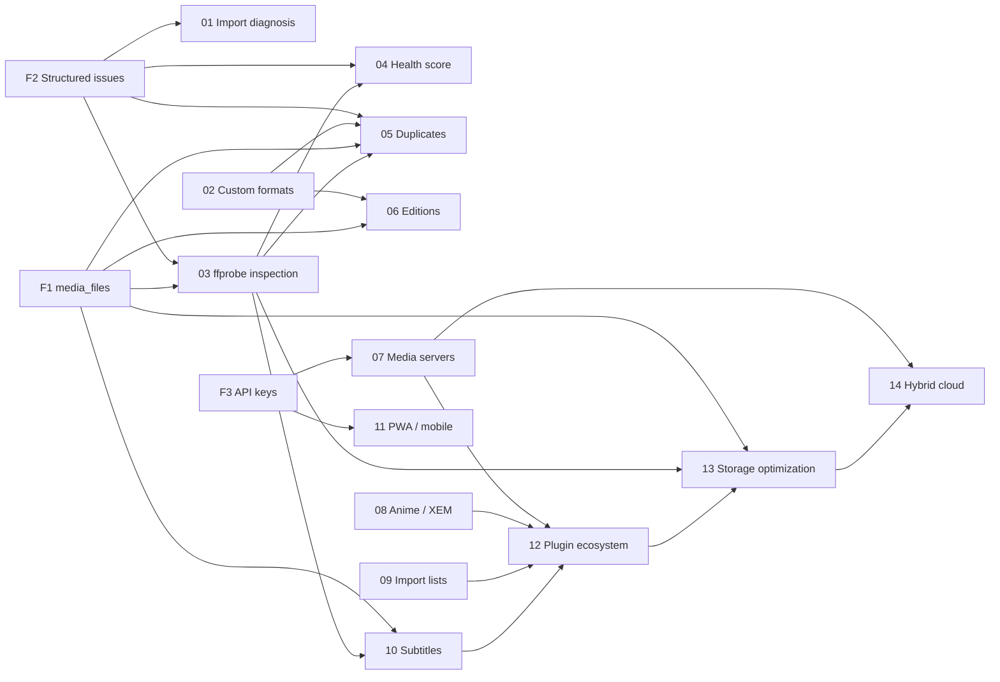

# Maniac Media – Feature Roadmap

This folder turns the post-v2.1 feature brainstorm into a prioritised, dependency-aware plan.
Each numbered document is a self-contained implementation plan: current state, design per layer
(domain → data → services → plugins → jobs → API → frontend), PR-sized steps, tests, risks and
acceptance criteria.

It supersedes the short list in [ARCHITECTURE.md §18](../ARCHITECTURE.md#18-next-roadmap).
The architecture rules in [ARCHITECTURE.md](../ARCHITECTURE.md) and [CLAUDE.md](../../CLAUDE.md) still
apply to all of it. Where a plan here conflicts with them, those two files win, or the plan has to
say explicitly why it deviates.

---

## 1. How features were prioritised

Each candidate was scored on four axes:

| Axis | Question |
|---|---|
| **User value** (1–5) | How much daily friction does it remove, or how visibly does it set Maniac apart from Radarr/Sonarr? |
| **Effort** (S/M/L/XL) | S ≈ 2–4 dev-days, M ≈ 1–2 weeks, L ≈ 2–3 weeks, XL ≈ 4+ weeks (one developer, incl. tests + UI) |
| **Risk** | Can it destroy user data (deletes, transcodes, moves)? Does it depend on fragile third-party APIs? |
| **Unlocks** | How many other features become cheaper once it exists? |

Two rules then shaped the order:

1. **Foundations go first, but only just before they're needed.** Three pieces of groundwork
   (F1–F3) don't do much for users on their own, but several features depend on them. Each one
   is scheduled right before the first feature that needs it.
2. **Destructive automation comes last.** Anything that deletes, transcodes or moves media ships
   only after the diagnosis, inspection and duplicate tooling exists to make it safe and
   explainable. It's also always off by default, supports a dry run, sends files to the recycle
   bin rather than deleting them, and writes an audit entry.

---

## 2. Priority list

| Rank | ID | Feature | Phase | Value | Effort | Risk | Depends on | Doc |
|---:|---|---|:-:|:-:|:-:|---|---|---|
| 1 | F2 | Structured library issues | 1 | 3 | S | Low | – | [F2](F2-structured-issues.md) |
| 2 | 01 | Import failure diagnosis & auto-fix | 1 | 5 | M | Low | F2 (soft) | [01](01-import-failure-diagnosis.md) |
| 3 | 02 | Custom formats & advanced release scoring | 1 | 5 | L | Low | – | [02](02-custom-formats.md) |
| 4 | F1 | `media_files` foundation | 2 | 2 | M-L | Medium (migration) | – | [F1](F1-media-files.md) |
| 5 | 03 | Media inspection via ffprobe | 2 | 4 | M | Low | F1, F2 | [03](03-media-inspection-ffprobe.md) |
| 6 | 04 | Library health score & dashboard | 2 | 4 | M | Low | F2 (03 improves it) | [04](04-library-health-score.md) |
| 7 | 05 | Deep duplicate intelligence & consolidation | 2 | 5 | M-L | Medium (deletes) | F1, F2, 03 | [05](05-duplicate-intelligence.md) |
| 8 | F3 | API keys | 3 | 3 | S | Low | – | [F3](F3-api-keys.md) |
| 9 | 07 | Plex/Jellyfin/Emby integration & watch-driven automation | 3 | 5 | XL (staged) | Medium (deletes) | F3 (webhooks), F1 | [07](07-media-server-integration.md) |
| 10 | 06 | Edition-aware movie & episode tracking | 3 | 4 | L | Low | 02, F1 | [06](06-edition-tracking.md) |
| 11 | 08 | Anime absolute numbering, XEM & alternate titles | 3 | 4 | L | Medium (external API) | – | [08](08-anime-scene-mapping.md) |
| 12 | 09 | Import lists & collection tracking | 4 | 4 | L | Medium (external APIs) | – | [09](09-import-lists-collections.md) |
| 13 | 10 | Subtitle providers & subtitle lifecycle | 4 | 4 | L | Medium (quotas) | F1, 03 | [10](10-subtitles.md) |
| 14 | 11 | PWA / mobile experience | 4 | 3 | M | Low | F3 (optional) | [11](11-pwa-mobile.md) |
| 15 | 12 | Plugin ecosystem hardening | 5 | 3 | M | Low | 07/08/09/10 add kinds | [12](12-plugin-ecosystem.md) |
| 16 | 13 | Smart storage optimization (strip, transcode) | 5 | 4 | XL | **High** | F1, 03, 12 | [13](13-storage-optimization.md) |
| 17 | 14 | Hybrid cloud & tiered storage | 6 | 3 | XL (staged) | **High** | F1, 07, 13 | [14](14-hybrid-cloud-storage.md) |
| – | 15 | Deferred & reframed ideas | – | – | – | – | – | [15](15-deferred-and-reframed.md) |

### Why this order (short version)

- **F2 → 01 first.** The dashboard already shows "failures in the last 7 days" (the screenshot
  that prompted the brainstorm showed 93). Today those failures are free-text strings
  ([import_service.py:33](../../backend/services/import_service.py#L33),
  [import_service.py:389-403](../../backend/services/import_service.py#L389-L403)). Turning them into
  structured diagnoses with suggested fixes needs no new infrastructure and helps every user
  straight away.
- **02 next.** Custom formats are the biggest feature Radarr and Sonarr have that Maniac lacks.
  Almost all of the work is pure domain code. It also unlocks edition preferences (06) and gives
  the duplicate recommendations in 05 something better than raw quality to compare on.
- **F1 → 03 → 04 → 05 as a block.** Inspection, the health score and duplicates all need to talk
  about individual files, and today there's no file entity. They make sense to build together.
  Inspection also covers most of what the brainstorm called "AI metadata correction": the runtime
  and resolution checks are deterministic and catch mislabelled files and wrong episodes.
- **F3 → 07.** Library refresh (07 stage A) is cheap and valuable. Watch-history rules are the
  standout differentiator, but they delete things, so they come after 05 has proven the
  delete-safely machinery.
- **06, 08, 09, 10 are independent** after their dependencies, so they can be reordered to suit
  what you need most. Anime (08) moves up if your library has a lot of anime.
- **13 and 14 last.** They're the most destructive and most invasive items: transcoding
  rewrites media, and cloud tiering touches every path operation. Both are staged so that the
  report-only first stage ships long before anything touches data.

---

## 3. Phase plan

| Phase | Theme | Contents | Ships to users |
|---|---|---|---|
| 1 | *Explain & score* | F2, 01, 02 | "Why did this fail and how do I fix it?", custom formats, TRaSH import |
| 2 | *Know your files* | F1, 03, 04, 05 | Technical info panel, mislabelled-file detection, health score, duplicate manager |
| 3 | *Connected library* | F3, 07 (A→C), 06, 08 | API keys, media-server refresh, watch-driven rules, editions, anime |
| 4 | *Acquire & enrich* | 09, 10, 11 | Import lists/collections, subtitles, installable PWA with push |
| 5 | *Optimise* | 12, 13 | Plugin API v1, storage policies (report → strip tracks → transcode) |
| 6 | *Scale out storage* | 14 | Multiple root folders, tiering, remote-mount mode, archive backends |

Each phase ends with a minor release (`v2.2` … `v2.7`). Every feature doc lists its own
milestones, and each milestone is sized to merge on its own behind a settings flag if needed.

---

## 4. Dependency graph

---

## 5. Cross-cutting conventions (apply to every feature)

These restate existing rules as a checklist for feature work. Don't relax them for a single
feature.

### Layering
- Pure logic goes in `backend/domain/` (no DB, no I/O, no app imports) and gets unit tests without
  fixtures. Every feature here has a domain module: `diagnosis.py`, `custom_formats.py`,
  `inspection.py`, `health_score.py`, `duplicates.py`, `editions.py`, `issues.py`, `subtitles.py`,
  `storage_policy.py`, `automation.py`.
- Provider code lives in `backend/plugins/<kind>s/` and is resolved through
  [registry.py](../../backend/plugins/registry.py). A new plugin kind means adding a member to
  `PluginKind` ([base.py:17](../../backend/plugins/base.py#L17)) and a `BUILTIN_PACKAGES` entry
  ([registry.py:33](../../backend/plugins/registry.py#L33)). Services never import a concrete plugin.
- Services orchestrate. Routers stay thin. DB-only endpoints are `def`; network endpoints are
  `async`; filesystem-heavy work goes through `asyncio.to_thread`.

### Data & migrations
- One Alembic revision per feature milestone. The docs write revisions as `NNNN_<name>`; assign the
  next free number (`0004`, `0005`, …) at merge time, because the merge order may differ from this plan.
  Migrations are **additive only** and **idempotent**: follow
  [0003_queue_client_position.py](../../backend/db/migrations/versions/0003_queue_client_position.py)
  and inspect existing columns/tables before creating them.
- Sizes are `BigInteger`. Paths are `String(1024)`. For uniqueness on a path, store a
  `path_hash String(64)` (sha256 of the normalised, lower-cased path) and index that: MySQL can't
  unique-index a 1024-char utf8mb4 column. `scan_state` already does this.
- Secrets use `EncryptedString("<table>.<column>")` ([base.py](../../backend/db/base.py)) and are
  write-only through the API (`has_x` flags in responses).
- Declare `ForeignKey`s on new tables. The migration wizard copies `Base.metadata.sorted_tables` in
  FK order ([database_service.py:118](../../backend/services/database_service.py#L118)), so new
  tables are carried across engines automatically, but only if their FKs are declared. Avoid FK
  cycles.
- Queries belong in [repositories.py](../../backend/db/repositories.py). Any new sortable list
  declares a `sortable` whitelist.
- JSON columns must stay portable across SQLite, PostgreSQL, MySQL and MSSQL. Don't filter on JSON
  paths in SQL: promote a field you need to query into a real column.

### Background work
- Register handlers in [tasks.py](../../backend/workers/tasks.py) with `@job_queue.register`. Add
  scheduled defaults to `SCHEDULED_DEFAULTS` ([tasks.py:131](../../backend/workers/tasks.py#L131)).
  Use `dedupe_key`. For large backlogs, use the self-continuing pattern from `metadata_refresh`.
- No ad-hoc `asyncio.create_task` for durable work.

### Filesystem safety
- Every media write, move or delete goes through `fileops.FileTransaction`
  ([fileops.py:202](../../backend/services/fileops.py#L202)). Replaced or removed media goes to
  the recycle bin, never `os.remove`.
- **Destructive automation contract:** off by default · dry-run preview endpoint · recycle bin ·
  `audit()` entry in the same transaction · per-run cap (e.g. at most N files or GB per run) ·
  notification event.

### API & security
- Base path `/api/v1`, paginated lists (`{items,total,page,page_size,pages}`), `{"detail": …}`
  errors.
- Reuse existing `Permission`s ([security.py:26](../../backend/core/security.py#L26)) where they fit.
  Add a new one only for genuinely new capability classes (e.g. `automation:manage`).
- Outbound HTTP uses the shared retry client in `core/http.py`. New secret shapes (Plex tokens,
  OAuth refresh tokens) get patterns added to `RedactingFilter`.
- Any user-supplied regex (custom formats, rules) is length-capped, compile-checked, and only
  editable with `SETTINGS_WRITE`.

### Events, notifications, metrics
- Add constants to `EventType` ([events.py:20](../../backend/core/events.py#L20)). The WebSocket
  fan-out and notification channels pick them up automatically.
- Prometheus metrics use the `maniac_` prefix in [observability.py](../../backend/core/observability.py),
  with low-cardinality labels (reason codes, never titles or paths).

### Frontend
- Types go in `frontend/src/api/types.ts`. Server state goes through React Query, and live updates
  come through `useLiveEvents`.
- New settings live under `pages/settings/`. New top-level views are added to `Layout.tsx`
  navigation.
- Charts follow one consistent visual system (light and dark themes, accessible palette).

### Testing
- **Unit:** every domain module has table-driven tests, with real-world release names and ffprobe
  JSON fixtures in `tests/fixtures/`.
- **Integration:** each API surface is exercised through `TestClient`. External providers are
  mocked with `httpx.MockTransport`, never called live.
- **E2E:** at least one Playwright test per new page (renders, primary action).
- The coverage gate (65 %) must not drop. New modules should aim for ≥ 80 %.

---

## 6. Brainstorm → roadmap mapping

Every idea from both brainstorm documents is accounted for below.

| Brainstorm idea | Where it went |
|---|---|
| Custom formats & advanced release scoring | [02](02-custom-formats.md) |
| Anime absolute numbering & scene mapping (XEM) | [08](08-anime-scene-mapping.md) |
| Import lists & collection tracking (Trakt, IMDb, Plex watchlist) | [09](09-import-lists-collections.md) |
| Media inspection via ffprobe | [03](03-media-inspection-ffprobe.md) |
| Built-in file health checking (integrity, missing audio/subs, mislabelled) | [03](03-media-inspection-ffprobe.md) + [F2](F2-structured-issues.md) |
| Subtitle provider plugins / automatic subtitle management | [10](10-subtitles.md) (auto-sync correction → [15](15-deferred-and-reframed.md)) |
| Plex/Jellyfin/Emby watch-history automation / real-time sync | [07](07-media-server-integration.md) |
| Smart duplicate management / deep duplicate intelligence | [05](05-duplicate-intelligence.md) |
| Multi-edition / multi-cut support; edition-aware tracking | [06](06-edition-tracking.md) |
| Smart storage optimization (transcode, strip tracks, compress extras) | [13](13-storage-optimization.md) |
| Storage heatmap | [13](13-storage-optimization.md) §Frontend |
| Library health score & dashboard | [04](04-library-health-score.md) |
| Context-aware import failure diagnosis & auto-fix | [01](01-import-failure-diagnosis.md) |
| Hybrid cloud + local storage, tiering, partial caching | [14](14-hybrid-cloud-storage.md) |
| Plugin ecosystem / custom importers, renamers, storage backends | [12](12-plugin-ecosystem.md) |
| AI-powered metadata correction | Reframed: deterministic checks in [03](03-media-inspection-ffprobe.md), alternate titles in [08](08-anime-scene-mapping.md), rest in [15](15-deferred-and-reframed.md) |
| Better handling of anime | [08](08-anime-scene-mapping.md) |
| Better handling of sports & documentaries | [15](15-deferred-and-reframed.md) (regional cuts partly via [06](06-edition-tracking.md)) |
| A real mobile app | [11](11-pwa-mobile.md) (PWA now, native later) |
| Smart airing calendar | [15](15-deferred-and-reframed.md) (+ "pause if behind" in [07](07-media-server-integration.md)) |
| Unified "everything" dashboard | Assembled from [04](04-library-health-score.md), [01](01-import-failure-diagnosis.md), [07](07-media-server-integration.md), [13](13-storage-optimization.md); see [15](15-deferred-and-reframed.md) |
| API keys for integrations (ARCHITECTURE §18.5) | [F3](F3-api-keys.md) |
| Plex/Jellyfin library-refresh notifications (ARCHITECTURE §18.7) | [07](07-media-server-integration.md) stage A |
| OIDC single sign-on, Helm chart, read replicas (ARCHITECTURE §18.5–6) | [15](15-deferred-and-reframed.md) |

---

## 7. Document template

Every feature document uses the same sections, so they can be compared side by side:

1. **Summary & user value**
2. **Current state** (what exists today, with links into the code)
3. **Scope** (MVP / later / out of scope)
4. **Design**: domain · data model & migration · services · plugins · jobs · API · frontend ·
   events/notifications/metrics · security
5. **Implementation milestones** (PR-sized)
6. **Testing**
7. **Risks & open questions**
8. **Acceptance criteria**
